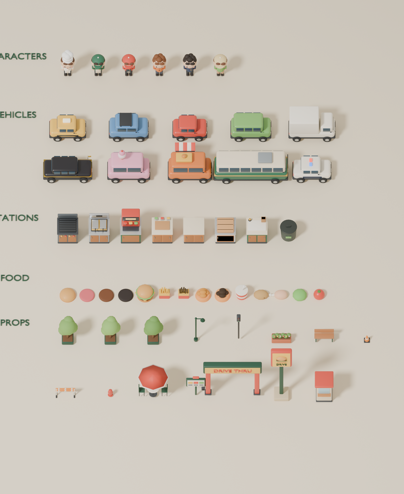

# Restaurant Game Engine｜經營模擬遊戲模板

用 Three.js（React Three Fiber）製作的等角 3D 經營模擬／限時料理遊戲模板。
內含一款完整可玩的範例遊戲 **Drive-Thru Dash｜得來速餐廳大作戰**（8 關）。



## 快速開始
```bash
npm install
npm run dev
```

| 指令 | 用途 |
|---|---|
| `npm run dev` | 本機開發 |
| `npm test` | 遊戲規則單元測試 |
| `npm run build` | 型別檢查＋正式建置（Vercel 直接可用） |
| `npm run models` | 用 Blender 重新產生並壓縮所有 3D 模型（需 `pip install bpy`） |
| `npm run build:single` | 模型內嵌的單一套件建置（可放進 Claude artifact） |

## 文件
- [`CLAUDE.md`](CLAUDE.md)：架構與檔案地圖（給 Claude 讀，開新遊戲時省 token）
- [`docs/NEW_GAME_GUIDE.md`](docs/NEW_GAME_GUIDE.md)：用模板開新遊戲的步驟
- [`docs/PROMPT_TEMPLATE.md`](docs/PROMPT_TEMPLATE.md)：開新遊戲時貼給 Claude 的提示詞範本

## 內建功能
訂單／排隊／耐心／連擊／評價／三星結算／升級 · 8 關＋天氣與事件 · 中英文切換 · 白天晚上切換 ·
開始畫面選關 · 鍵盤、手把、手機搖桿 · 手機精簡 HUD · 環狀道路與城市車流 · Blender 3D 資產流水線 · localStorage 存檔

## 技術
React 18 · TypeScript · Vite 5 · three 0.169 · @react-three/fiber 8 · drei 9 · Zustand · Vitest · Blender 5 (bpy) · glTF Transform
